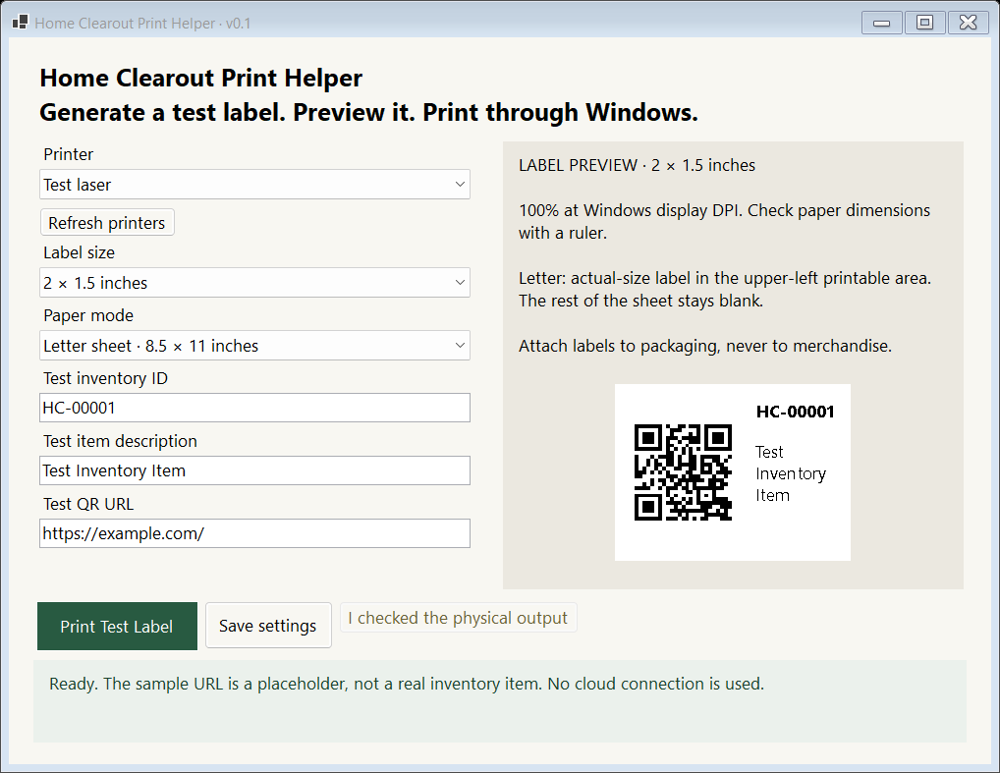
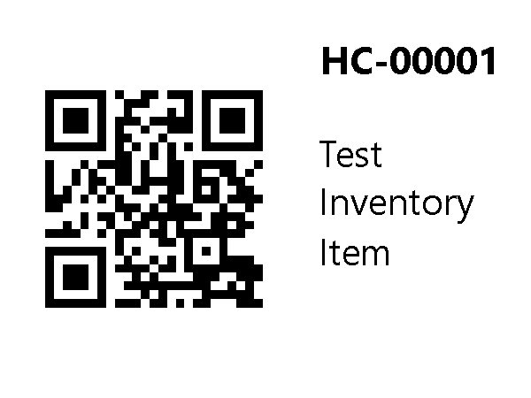

# Version 0.1 verification

Validated October 15, 2026 on the development Windows x64 computer. No physical
Brother/thermal printer is installed here; no physical print jobs were sent.

## Automated and local checks

- **22 tests passed** locally with Microsoft Print to PDF enabled. The regular
  Windows CI suite has 21 tests; the optional real PDF-driver test is the 22nd.
- Real QRCoder generation independently decoded by ZXing.Net at all three sizes,
  both 300 dpi and typical 203 dpi thermal resolution. A configurable alternate
  test URL decodes exactly as entered.
- Label dimensions, non-overlapping QR/text bounds, readable font fitting,
  invalid URLs, excessive/dense text and invalid dimensions/DPI are checked.
- Settings round trips, missing/corrupt/unknown-version fallbacks, retained
  unreadable files, and an unavailable saved printer are checked. A disconnected
  preferred printer cannot silently switch to another printer.
- Real WinForms controls/preview render in an offscreen test window for visual
  review. Tests use synthetic printer names and isolated settings directories.
- The actual Windows Microsoft Print to PDF driver produced a Letter page
  (612 x 792 points). The label measures 144 x 108 points: exactly 2 x 1.5 inches.
  The remaining Letter sheet is blank. The PDF was rasterized and its QR
  independently decoded back to `https://example.com/`.
- Portable executable startup is checked without opening a window or printing:
  x64 process, bundled core runtime, label rendering and printer discovery.
  This is stronger than merely building a DLL. No separate user runtime is needed.
- Locked dependency restore, build, self-contained single-file publish, packaging
  and SHA-256 output are checked. A standalone startup check runs in GitHub Actions
  before the downloadable artifact is uploaded.

Commands are in the README. Test output under `artifacts/` is ignored by Git;
GitHub Actions uploads its results separately. The diagnostic mode does not print.

## Physical acceptance checks still needed

1. Install/connect the Brother driver on this computer; select that printer.
2. Print once in Letter mode at each label size. Measure width/height with a ruler,
   confirm the upper-left printable placement, and scan each QR using a real phone.
3. Unplug/offline the printer. Check the message/Windows queue; do not assume a
   return from Windows means paper output. Reconnect and reconcile before retrying.
4. Change driver settings/media and test thermal custom paper mode on the actual
   printer. Confirm margins, orientation, scaling, contrast and label feed behavior.
5. Close/reopen and confirm preferred printer, size, paper mode and URL persist.
6. Copy the portable ZIP to the second computer, extract, open, and select its
   installed printer. No copied path, cloud account or SDK should be needed.
7. Run on the Surface Pro 4's Windows 10 x64 installation. Confirm startup, display
   scaling, preview and printing on that actual device. Technical compatibility
   does not replace Microsoft's Windows security support requirements.

The executable is unsigned. Reputation prompts/code signing, physical media/drivers,
real camera/autofocus and Windows 10 device operation cannot be validated by the
software-only tests. Do not disable security protections to test it.

